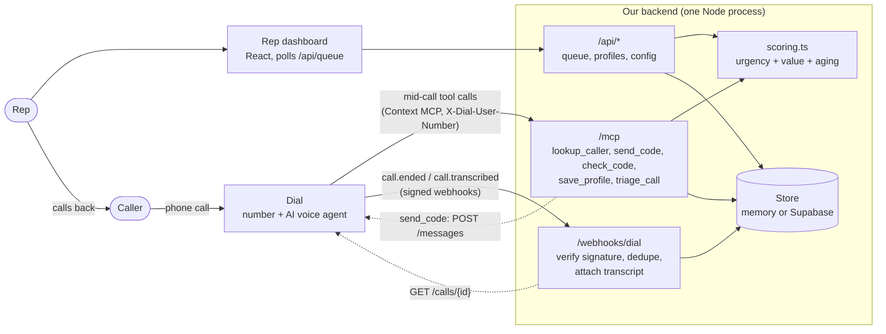

# Architecture

One small backend does everything Dial doesn't. Dial owns the phone number, the voice agent, and SMS. We own identity, verification, priority, and the rep's queue.

## Components

| Piece | Where | Job |
|---|---|---|
| Voice agent + number + SMS | Dial | Answers calls, speaks, texts codes. Configured by `docs/inbound-prompt.md`. |
| MCP endpoint | `server/src/mcp.ts` | The five tools the agent calls mid-call. Stateless: a fresh server per request, closed over the caller. |
| Webhook receiver | `server/src/app.ts`, `events.ts`, `webhook.ts` | Verifies `X-Dial-Signature`, dedupes retries, links calls to queue items, stores transcripts. |
| Scoring | `server/src/scoring.ts` | Pure functions. One table drives the tools, the API, and the dashboard's "how the order is decided" panel. |
| Store | `server/src/store/` | `Store` interface. In-memory by default (zero setup), Supabase for persistence. |
| Dashboard | `web/` | Polls `/api/queue` every 1.5 s. Timers and the aging bar tick client-side between polls. |

## Call flows

**First call.** The agent calls `lookup_caller` (unknown), collects the issue, offers to save details, then `send_code` → caller reads digits → `check_code` → `save_profile`. Finally `triage_call` queues a callback with a brief the agent wrote, and the agent ends the call.

**Returning call.** `lookup_caller` returns the name and last issue. The agent greets by name. Low-risk requests go straight to `triage_call`. Requests that move money or change an account (`money_movement`, `account_change`) are refused by the server until the number has passed a code check in the last 10 minutes.

## Trust model

| Question | Answer |
|---|---|
| Who is calling? | `X-Dial-User-Number`. Recognizes a profile; never authorizes by itself, because caller ID can be spoofed. |
| Can they act on the account? | Only after a texted 6-digit code (5 min expiry, 5 attempts, 3 sends per 10 min, hashed at rest, consumed on use). Verified for 10 minutes. |
| Can a tool read someone else's data? | No. No tool takes a phone number as an argument. Identity comes only from the headers. |
| Can a stranger call our tools? | `MCP_SHARED_SECRET` is required on `/mcp` (header `X-Mcp-Secret`, bearer token, or `/mcp/<secret>` in the URL). Production refuses to boot without it. |
| Are webhooks genuine? | HMAC-SHA256 over `{t}.{rawBody}`, 5-minute tolerance, constant-time compare, deduped on event id. |
| Does the dashboard leak numbers? | The list masks them. The full number is released only when a rep clicks Call back. |

## Data model

`profiles` (phone, name, consent_at, verified_at) · `verifications` (code hash, expiry, attempts, send window, verified_until) · `queue_items` (phone, intent, amount, summary, trust, status, call_id, transcript) · `seen_events`. SQL in `server/supabase/schema.sql`, RLS on with no policies.

## Scoring

`score = urgency + value + aging`, computed at read time so the order shifts live.

- **Urgency** by intent: fraud / medical emergency 100, locked out 60, payment problem 40, moving money 35, account change 25, dispute 20, new account 20, general / other 10.
- **Value** by amount: $100+ 8, $1k+ 16, $10k+ 24, $100k+ 32, $1M+ 40.
- **Aging** `AGING_PER_MIN` points per minute (default 2), capped at `AGING_CAP` (150). At the defaults, a general question that has waited 75 minutes outranks a brand-new emergency.

Demo check: fraud $4,200 = 116, $10M account opening = 60, $12 dispute = 20. After 45 minutes the dispute is 110 and overtakes a fresh $10M opening. This is covered by tests.

## Decisions that differ from the original plan

1. **The agent writes the brief, not a transcript summarizer.** `triage_call` takes a `summary`, so the brief is on the dashboard the instant the call ends and needs no LLM key. The transcript webhook only attaches the full transcript.
2. **Calls are linked by caller number, not call id.** Mid-call tool requests carry the caller's number but no call id, so `call.ended` links the queue item (number + time window) and `call.transcribed` finds it by call id.
3. **`call.transcribed` carries only a `callId`.** The transcript and number come from `GET /calls/{id}`, so the webhook handler fetches the call record.
4. **Backend must be a long-running process** (Railway, Render, Fly, or a laptop with a tunnel), not Vercel functions. Webhooks answer first and process after; OTP rate-limit state and demo codes live in process memory. Vercel is for the dashboard.
5. **Dashboard polls the backend, not Supabase.** No anon key, no RLS policies, no realtime setup.

## Failure modes and fallbacks

| Failure | What happens |
|---|---|
| SMS not delivered | Set `DEMO_SHOW_CODES=true`: the code is shown on the dashboard and `send_code` succeeds even if Dial's send fails. |
| Dial headers missing during tool discovery | Tools return `caller_unknown` instead of crashing. |
| Agent calls `triage_call` twice | Updates the waiting item (within 3 min), keeps the original wait time. |
| Webhook retried | Deduped on `X-Dial-Event-ID`. |
| Server restarts (memory store) | Queue clears, seeded callers reload. Use Supabase to persist. |
| Dashboard loses the server | Banner, last data stays on screen, polling continues. |

## Extension points (sponsor stretch goals)

- **Keewano:** add a `KeewanoStore` or write each queue item as an event, and return the last few from `lookup_caller` (`last_issue` is the hook).
- **Alike:** after `triage_call`, push the brief to the rep's agent instead of waiting for the dashboard.
- **Darwin:** list the line so a consumer's agent can find it; or route `intent` to departments.
- **Multi-company:** `X-Dial-Agent-Number` identifies which line was dialed and is already stored on each item.
