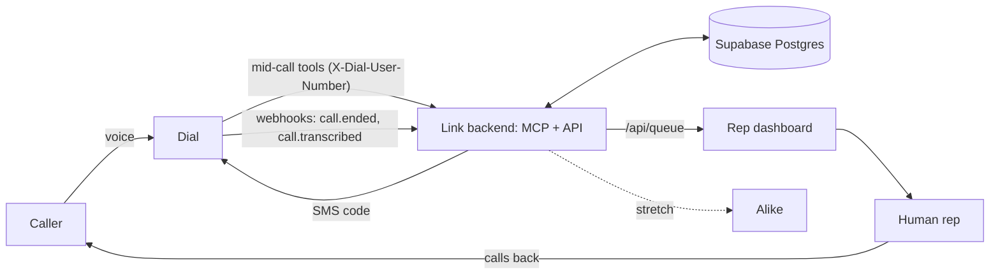

# Architecture

- **Dial** does all telephony: answers, talks, sends SMS. We configure it, we don't build it. See [[dial]].
- **Link backend** is the one service we write: MCP server + webhook receiver + small JSON API. One process, one port.
- **Dashboard** polls `/api/queue` every 2 s. No websockets.
- **Callbacks, not transfers**: Dial can't hand a live call to a human mid-call, so the agent ends the call with an ETA and a rep calls back.

Areas: [[areas/voice]] · [[areas/backend]] · [[areas/dashboard]] · [[areas/stretch]]
